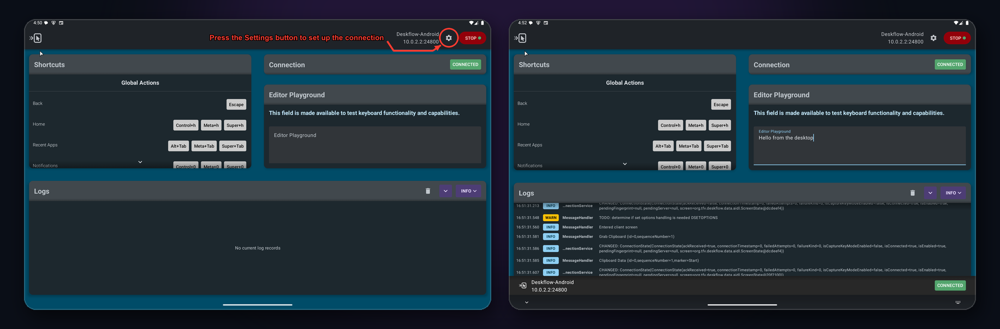
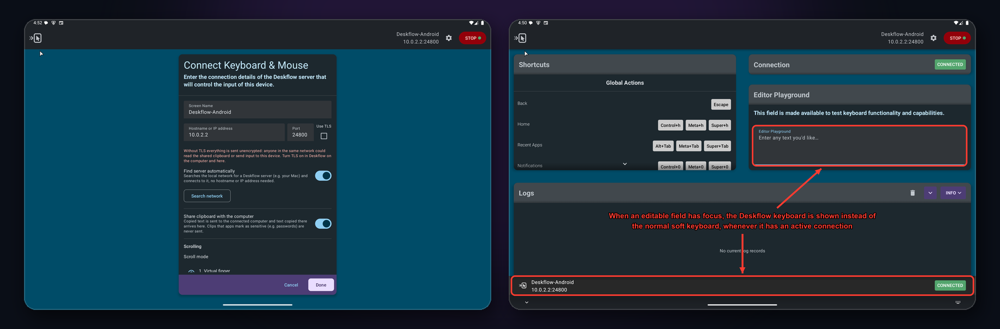
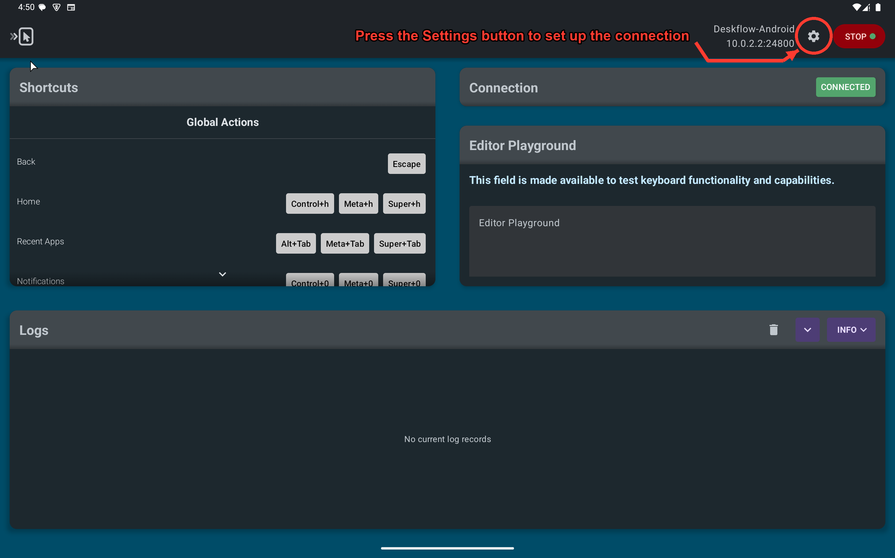
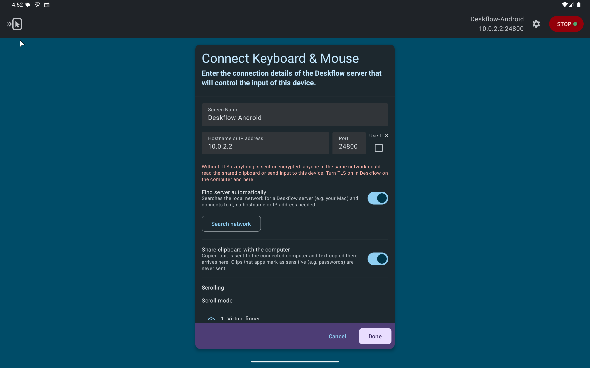
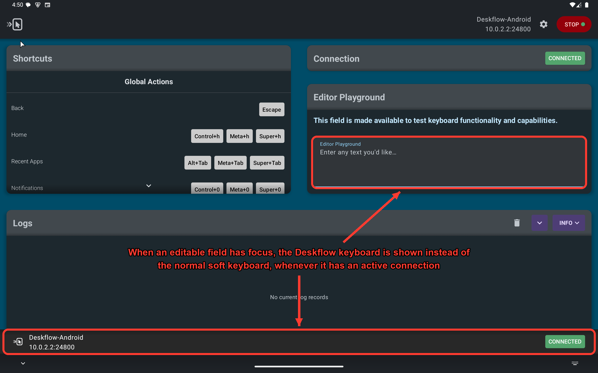

# Deskflow Android (Enhanced)

Use the keyboard, mouse and trackpad of your desktop (e.g. your Mac) to control your Android phone or tablet,
just like any other Deskflow screen. This app is a **near** fully functional
[Deskflow (deskflow.org)](https://deskflow.org) client for Android.

It is an enhanced fork of [jglanz/deskflow-android](https://github.com/jglanz/deskflow-android). It adds smooth
content scrolling, full mouse button support, automatic server discovery and TLS client certificates.

**Who it's for:** people who already use Deskflow on their desktop and know how to configure a client/screen.

> **Unofficial project.** This is an independent client. It is not affiliated with, endorsed by or
> sponsored by the Deskflow project or Symless. "Deskflow" and "Synergy" only name the software this client
> works with. The app logo is an own design, not the Deskflow logo.

> [!WARNING]
> **Security notice for versions up to 1.0.15 (app id `org.tfv.deskflow`).** These old releases were signed
> with a *public* debug key. Anyone can sign a fake "update" with that key that Android would install over
> the old app – including its accessibility and keyboard permissions. If you still have one of these versions
> installed: **uninstall it** and install the current release (1.1.0 or newer, app id
> `de.juliandigitalproducts.deskflow`, signed with a private release key). Do not install old APKs any more.

## Features

- **Shortcuts & hotkeys**: app switching (`Command+Tab` or `Alt+Tab`), arrow keys for navigation,
  `Escape` for `Back`, and more
- **Clipboard**: text of any kind (bitmaps are **not** supported currently)
- **Content scrolling** with the mouse wheel or trackpad
  - vertical **and** horizontal, nothing keeps scrolling once you stop
  - 5 selectable scroll modes, adjustable smoothing & speed
  - scroll direction invertible separately for X and Y (e.g. for macOS natural scrolling)
- **Mouse buttons**: click & drag, long press (& long-press-drag), right click = long press,
  "Back" button = Android back
- **Automatic server discovery**: finds the Deskflow server on the local network via mDNS/Bonjour and a
  network scan, plain & TLS – no hostname or IP address needed
- **TLS incl. client certificates**: works with "Require client certificates" on the server (the Deskflow default)
- **Clear connection errors**: if the server rejects the screen name (unknown or already in use), the app
  disconnects and logs what to fix

## Requirements

- Android 14 or newer
- 64-bit ARM device (`arm64-v8a`)
- Deskflow on your desktop, running as server

## Download

Signed APKs are attached to the releases:
**[Releases](https://git.juliandigitalproducts.de/jdaniels/Deskflow-Android-Enhanced/releases)**

Open the link on your Android device and allow the installation from unknown sources.
All releases since 1.1.0 are signed with the same private release key, so new versions install as an update
over the existing app. Releases up to 1.0.15 used a public debug key – see the security notice above.

> NOTE: If the original Deskflow Android app is installed, uninstall it first (different signature).

Building it yourself? Build, tests, CI and signing are covered in [docs/BUILD.md](docs/BUILD.md).

## Screenshots

**Tablet — Dashboard & Active Connection**

**Settings & Input Method — Network Discovery & Keyboard Controls**

## Setup

### 1. On the Deskflow server

1. Give the server computer its **own** name (`Computer name` in the Deskflow main window).
2. Open `Configure Server` and drag a **new** screen next to your computer.
3. Name it exactly like the `Screen Name` in the Android app (default: `Deskflow-Android`) and save.

### 2. In the app

On first launch, tap the gear in the top right corner to open the settings.

- `Screen Name` – the name you configured on the Deskflow server.
- `Host` & `Port` of your Deskflow server, or `Search network` to pick a found server.
- `Use TLS` if your server uses TLS (set automatically when picking a found server).

Press `Save` – the app returns to the home screen and immediately tries to connect.

### 3. TLS: trust each other once

TLS is fully supported, including "Require client certificates". On the first TLS connection the app creates
its own client certificate (stored in the Android Keystore, it never leaves the device). Deskflow on the server
then asks whether to trust this device's fingerprint – compare it with the one shown in the app settings
(visible when `Use TLS` is on) and accept. The app in turn shows the server's fingerprint (see
[Security](#security)). After that, connecting is automatic.

### Automatic server discovery

- `Search network` lists all Deskflow servers found on the local network, with computer name, address and
  whether TLS is used. Tap one to use it.
- `Find server automatically` (on by default): if no server is configured, or the configured one can't be
  reached for a while, the app searches the network and connects to the server found. It also follows the
  server when its IP address changes.

> NOTE: On the very first app start nothing connects automatically. Discovery starts once you have saved the
> connection settings.

## Scrolling

Set up in the `Scrolling` section of the settings.

| Scroll mode               | How it works                                                                    |
|---------------------------|---------------------------------------------------------------------------------|
| 1. Virtual finger         | A finger stays on the screen and follows the wheel/trackpad directly            |
| 2. Short swipes           | Scrolling is collected briefly and applied as short swipes, one after another   |
| 3. Flick (momentum)       | One swipe with momentum per scroll movement, like flicking with a finger        |
| 4. Fixed steps            | Even, calm steps without momentum                                               |
| 5. Page by page           | No gestures, the scrollable view under the pointer scrolls by pages (very stable) |

- `Smoothing` – higher is smoother but reacts a bit later (modes 1-3, and the pause between pages in mode 5).
- `Invert vertical / horizontal scrolling` – per axis.
- `Scroll speed` – 25% - 300%.

Every scroll movement is locked to its main direction, so a trackpad's small sideways movement doesn't move
tabs, carousels or home screen pages.

> TIP: macOS keeps sending scroll events after a quick trackpad swipe (inertia). To turn it off:
> System Settings → Accessibility → Pointer Control → Trackpad Options → Scrolling "without inertia".

## Mouse

| Mouse                               | Android                                    |
|-------------------------------------|--------------------------------------------|
| Left click                          | Tap                                        |
| Left button held & moved            | Drag                                       |
| Left button held without moving     | Long press (moving afterwards drags)       |
| Right click                         | Long press (e.g. context menu)             |
| Back button                         | Back                                       |

## Keyboard (IME)

The Deskflow Android Keyboard is a custom input method that shows the current connection status:

> IMPORTANT: **While connected to a Deskflow server**, the app always tries to force the
> `Deskflow Android Keyboard`, so server and client work together seamlessly. Want your regular soft/hard
> keyboard back? Stop the connection with the start/stop button in the top right corner of the app.

## Troubleshooting

| Server log / app log                                    | Solution                                                                                                 |
|---------------------------------------------------------|----------------------------------------------------------------------------------------------------------|
| `a client with name "..." is already connected`         | The server computer itself or another device uses the same name, give each a unique name                  |
| `unrecognised client name "..."`                        | Add a screen with exactly the app's `Screen Name` in `Configure Server`                                  |
| `peer did not return a certificate`                     | Enable `Use TLS` in the app and accept the fingerprint on the server                                     |
| `Search network` finds nothing                          | Make sure the server is running and both devices are in the same Wi-Fi/network                           |
| App shows `TLS error`                                   | `Use TLS` must match the server: switch TLS on (or off) in Deskflow on the computer *and* in the app      |
| App shows `Not reachable`                               | Check address and port, that Deskflow runs on the computer and that both devices share the network      |
| App stopped working after "Force stop"                  | Android switches the accessibility service off on a force stop; enable Deskflow again under *Settings → Accessibility* |

> **Force stop:** "Force stop" in the Android app info (or `adb shell am force-stop`) does more than end the
> app: Android also removes Deskflow from the enabled accessibility services. This is platform behaviour, not a
> crash. Afterwards, open the app and enable the accessibility service again. To pause Deskflow, use the
> STOP button in the app instead.

## Security

**Trusting your server.** With **Use TLS** on, the app checks the server's certificate fingerprint. On the first
connection to a server it shows the SHA-256 fingerprint; compare it with the one Deskflow shows on your
computer and tap **Fingerprint matches – trust**. Only then does the app accept input from that server. If the
fingerprint ever changes (other device, reinstalled Deskflow), you are asked again. Automatic server search
only switches to servers you trusted; without TLS a server cannot prove who it is, so plaintext servers are
never picked automatically.

**Clipboard.** Sharing is off by default (Settings → *Share clipboard with the computer*); clips that apps
mark as sensitive, e.g. passwords, are never sent.

## Credits

- [jglanz/deskflow-android](https://github.com/jglanz/deskflow-android) by Jonathan Glanz – the project this
  fork is based on (his own files: MIT).
- synergy-android by Shaun Patterson and the Synergy/Deskflow project – the client's protocol layer goes back
  to it (GPL version 2).

## License

GNU General Public License, version 2 – see `COPYING`. Which files are MIT and why the whole app is GPL:
`LICENSE.md` and `NOTICE`. `LICENSE.md` also documents a known license issue (section *Known license issue*).
Whoever passes on an APK must also offer the matching source code.

## Contact

Copyright & maintainer: juliandigitalproducts (see `NOTICE`).
Legal notice / contact: [juliandigitalproducts.de/impressum](https://juliandigitalproducts.de/impressum)
